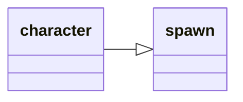

# `character`

<!--dt-desc-start-->
This data type contains all the information about _your_ character.
<!--dt-desc-end-->
## Inheritance

This type inherits members from [_spawn_](datatype-spawn.md).



## Members
<!--dt-members-start-->
The [source](https://github.com/macroquest/macroquest/blob/master/src/main/datatypes/MQ2CharacterType.cpp) always has the latest data members.
If something is missing here, you can check the source to see if it exists.

/// member | int AAExp
AA exp as a raw number out of 10,000 (10,000=100%)
///

/// member | int AAPoints
Unused AA points
///

/// member | int AAPointsAssigned
Number of AA Points currently assigned
///

/// member | int AAPointsSpent
The number of points you have spent on AA abilities
///

/// member | int AAPointsTotal
The total number of AA points you have
///

/// member | int64 AAVitality
The total number of AA Vitality you have
///

/// member | int64 AAVitalityCap
///

/// member | string Ability[name]
Skill name assigned to this doability button
///

/// member | bool Ability[#|name]
Whether you have this ability or not
///

/// member | bool AbilityReady[#|name]
Whether this ability is ready (false if you do not have the ability)
///

/// member | timestamp AbilityTimer[#|name]
How long before an ability can be used again. Zero if it can currently be used or you do not have the ability.  nil if the skill is not an ability or the ability does not exist.
///

/// member | timestamp AbilityTimerTotal[#|name]
The total amount of time an ability takes to refresh. Zero if it is not currently active.
///

/// member | int AccuracyBonus
Accuracy bonus from gear and spells
///

/// member | spell ActiveDisc
Returns a spell if melee discipline is active.
///

/// member | int ActiveFavorCost
If Tribute is active, how much it is costing you every 10 minutes. Returns NULL if tribute is inactive.
///

/// member | int AdoptiveCoin
///

/// member | buff Aego
Returns the name of the Aegolism buff or equivalent (Aego, HP Buff, Symbol) from a Cleric.
///

/// member | spawn AggroLock
Spawn info for aggro lock player
///

/// member | int AGI
Character Agility
///

/// member | int AirSupply
///

/// member | altability AltAbility[#|name]
Returns the total number of points you have spent in ability # or name
///

/// member | bool AltAbilityReady[#|name]
Alt ability # or name ready?
///

/// member | int AltAbilityTimer[#|name]
Alt ability reuse time remaining (in ticks) for ability # or name
///

/// member | int AltCurrency[name]
The amount of alternate currency given the name (e.g. Marks of Valor)
///

/// member | bool AltTimerReady
Alternate timer ready? (Bash/Slam/Frenzy/Backstab). Note: ${AbilityReady} works fine with most of these.
///

/// member | bool AmIGroupLeader
Am I the group leader?
///

/// member | int AncientDraconicCoin
///

/// member | int AncientSebilisianCoins
///

/// member | bool AssistComplete
returns true/false if the assist is complete
///

/// member | int AttackBonus
Attack bonus from gear and spells
///

/// member | int AttackSpeed
Your Attack Speed. No haste spells/items = AttackSpeed of 100. A 41% haste item will result in an AttackSpeed of 141. This variable does not take into account spell or song haste.
///

/// member | auratype Aura
Aura data, if an aura is active.
///

/// member | bool AutoFire
Is Autofire on?
///

/// member | skill AutoSkill
///

/// member | int AvoidanceBonus
Avoidance bonus from gear/spells
///

/// member | bandolier Bandolier
Gives access to the bandolier datatype.
///

/// member | item Bank
Item in this bankslot #
///

/// member | bool BardSongPlaying
Is a bard song playing?
///

/// member | int BaseAGI
Base Agility
///

/// member | int BaseCHA
Base Charisma
///

/// member | int BaseDEX
Base Dexterity
///

/// member | int BaseINT
Base Intelligence
///

/// member | int BaseSTA
Base Stamana
///

/// member | int BaseSTR
Base Strength
///

/// member | int BaseWIS
Base Wisdom
///

/// member | int BathezidTradeGems
///

/// member | int Bayle
///

/// member | buff Beneficial
Returns the first Beneficial buff found in your list of buffs
///

/// member | int BifurcatedCoin
///

/// member | spell BlockedBuff
///

/// member | spell BlockedPetBuff[name]
Buff blocked by pet with this name
///

/// member | spell BlockedPetBuff[#]
Buff at this index slot # of the blocked pet buffs
///

/// member | int Book[name]
Slot in your spell book assigned to spell name
///

/// member | spell Book[#]
Spell assigned to this slot # in your spell book
///

/// member | worldlocation BoundLocation[#]
Returns information about your bind points (0-4)
///

/// member | int Brellium
///

/// member | buff Brells
Returns the Brell's line HP buff from a Paladin
///

/// member | int BronzeFiats
///

/// member | buff Buff[name]
The buff with this name
///

/// member | buff Buff[#]
The buff in this slot #
///

/// member | timestamp BuffDuration[name]
Override on the Spawn version for consistency. The time remaining on the buff or song matching this name. The name is matched as a case-insensitive substring; prefix `=` to require a case-insensitive exact match instead. Consistent with `Me.Buff[name].Duration`.
///

/// member | timestamp BuffDuration[#]
Override on the Spawn version for consistency. The time remaining on the buff or song in this slot #. Slots are numbered from 1 and span the long-duration buffs followed by the short-duration (song) buffs.
///

/// member | bool CanMount
Can you use a mount here?
///

/// member | int64 CareerFavor
Career favor/tribute
///

/// member | int64 Cash
Total cash on your character, expressed in coppers (eg. if you are carrying 100pp, Cash will return 100000)
///

/// member | int64 CashBank
Total cash in your bank, expressed in coppers
///

/// member | timestamp CastTimeLeft
///

/// member | int CHA
Character Charisma
///

/// member | buff Charmed
///

/// member | int Chronobines
Chronobines on your character
///

/// member | int ClairvoyanceBonus
Clairvoyance Bonus
///

/// member | buff Clarity
///

/// member | bool Combat
In combat?
///

/// member | spell CombatAbility[#]
The name of Combat Ability # in your list (not the same as anyone else's list!)
///

/// member | int CombatAbility[name]
The number of Combat ability name in your list (not the same as anyone else's list!)
///

/// member | bool CombatAbilityReady[name|#]
Is this Combat Ability ready?
///

/// member | int CombatAbilityTimer[name|#]
The time remaining (in seconds) before the Combat Ability name is usable
///

/// member | int CombatEffectsBonus
Combat Effects bonus from gear and spells
///

/// member | string CombatState
Returns the current out-of-combat resting state.

| Value | Meaning |
| --- | --- |
| COMBAT | You are currently in a combat state and can not rest yet |
| DEBUFFED | You can't rest now. You need to be cleansed before the cooldown will start |
| COOLDOWN | You are cooling down. OOC regen is ready when you are done cooling down |
| ACTIVE | You can rest now. You can use the OOC regen if you want |
| RESTING | You ARE resting now. the OOC regen is active |

If the client does not support this feature, ACTIVE will always be returned.

!!! Example

    ```text
    /if ${Me.CombatState.Equal[ACTIVE]} /echo I can now sit and regen fast
    /if ${Me.CombatState.Equal[DEBUFFED]} /echo I need cures before I can rest
    ```
///

/// member | int Commemoratives
///

/// member | int Copper
Copper on your character
///

/// member | int CopperBank
Copper in bank
///

/// member | spell Corrupted
Returns the name of the Corrupted debuff if you have one
///

/// member | int CountBuffs
Number of buffs you have, not including short duration buffs
///

/// member | int64 CountersCorruption
///

/// member | int64 CountersCurse
Number of curse counters you have
///

/// member | int64 CountersDisease
Number of disease counters you have
///

/// member | int64 CountersPoison
Number of poison counters you have
///

/// member | int CountSongs
Number of songs you have
///

/// member | int Crippled
///

/// member | int CrystallizedFear
///

/// member | int CryrstallizedLuck
///

/// member | int CurrentEndurance
Current endurance
///

/// member | int64 CurrentFavor
Current favor/tribute
///

/// member | int CurrentHPs
Current hit points
///

/// member | int CurrentMana
Current mana
///

/// member | int CurrentWeight
Current weight
///

/// member | spell Cursed
Returns the name of the Curse debuff if you are effected by one
///

/// member | int CursorCopper
///

/// member | int CursorGold
///

/// member | int CursorKrono
///

/// member | int CursorPlatinum
///

/// member | int CursorSilver
///

/// member | int DamageShieldBonus
Damage Shield bonus from gear and spells
///

/// member | int DamageShieldMitigationBonus
Damage Shield Mitigation bonus from gear and spells
///

/// member | int64 Dar
Damage absorption remaining (eg. from Rune-type spells)
///

/// member | int DEX
Character Dexterity
///

/// member | int DiamondCoins
///

/// member | string Diseased
Returns the name of first Disease spell on character
///

/// member | int DoTShieldBonus
DoT Shield bonus from gear and spells
///

/// member | string Dotted
Returns name of first DoT on character
///

/// member | int Doubloons
Doubloons on your character
///

/// member | ticks Downtime
Downtime (Ticks left til combat timer end)
///

/// member | int DreadStones
///

/// member | int Drunk
Drunkenness level
///

/// member | buff DSed
///

/// member | int EbonCrystals
Number of Ebon Crystals on your character
///

/// member | int Endurance
///

/// member | int EnduranceBonus
Endurance bonus from gear and spells
///

/// member | int EnduranceRegen
Endurance regen from the last tick
///

/// member | int EnduranceRegenBonus
Endurance regen bonus
///

/// member | int EnergyCrystals
///

/// member | int EntwinedDjinnCoins
///

/// member | int64 Exp
Experience (out of 10,000 on Live / out of 330 on Emu)
///

/// member | int ExpansionFlags
Returns a numeric number representing which expansions your toon is flagged for
///

/// member | int Faycites
Faycites on your character
///

/// member | buff Feared
///

/// member | fellowship Fellowship
Info about Fellowship
///

/// member | int FetteredIfritCoins
///

/// member | buff FindBuff
///

/// member | int Fists
///

/// member | buff Focus
///

/// member | int FreeBuffSlots
Number of open buff slots (not counting the short duration buff slots)
///

/// member | int FreeInventory
Number of free inventory spaces
///

/// member | int FreeInventory[#]
Number of free inventory spaces of at least # size (giant=4)
///

/// member | int FroststoneDucat
///

/// member | int Gem[name]
Returns the slot # with the spell name
///

/// member | spell Gem[#]
The name of the spell in this slot #
///

/// member | ticks GemTimer[name|#]
The timer for the spell with this name or in this gem #
///

/// member | int Gold
Gold on character
///

/// member | int GoldBank
Gold in bank
///

/// member | int GoldTokens
///

/// member | spawn GroupAssistTarget
Current group assist target
///

/// member | bool Grouped
Grouped?
///

/// member | string GroupList
Returns a string of your group members (excluding you)
///

/// member | spawn GroupMarkNPC[#]
Current group marked NPC (1-3)
///

/// member | int GroupSize
Size of group
///

/// member | buff Growth
///

/// member | int GukEarned
Total LDoN points earned in Deepest Guk
///

/// member | int64 GuildID
Returns the ID number of your guild
///

/// member | int Haste
Total Combined Haste (worn and spell) as shown in Inventory Window stats
///

/// member | buff Hasted
///

/// member | bool HaveExpansion[#]
Returns TRUE/FALSE if you have that expansion #
///

/// member | int HealAmountBonus
Total Heal Amount bonus from gear
///

/// member | int HeroicAGIBonus
Total Heroic Agility bonus from gear
///

/// member | int HeroicCHABonus
Total Heroic Charisma bonus from gear
///

/// member | int HeroicDEXBonus
Total Heroic Dexterity bonus from gear
///

/// member | int HeroicINTBonus
Total Heroic Intelligence bonus from gear
///

/// member | int HeroicSTABonus
Total Heroic Stamina bonus from gear
///

/// member | int HeroicSTRBonus
Total Heroic Strength bonus from gear
///

/// member | int HeroicWISBonus
Total Heroic Wisdom bonus from gear
///

/// member | int HPBonus
Hit point bonus from gear and spells
///

/// member | int HPRegen
Hit point regeneration from last tick
///

/// member | int HPRegenBonus
HP regen bonus from gear and spells
///

/// member | int Hunger
Hunger level
///

/// member | buff HybridHP
///

/// member | int ID
Spawn ID
///

/// member | bool InInstance
Returns TRUE/FALSE if you are in an instance.
///

/// member | int Instance
///

/// member | int INT
Character Intelligence
///

/// member | item Inventory[#]
Item in this slot #
///

/// member | item Inventory[slotname]
Item in this slotname (inventory slots only). See [Slot Names](../general/slot-names.md) for a list of slotnames.
///

/// member | bool Invited
Invited to group?
///

/// member | string Inviter
Name of player sending group invite
///

/// member | string Invulnerable
Returns the invulnerable spell name on you, can be used with spell datatype

```
${Me.Invulnerable.Spell.ID}
```
///

/// member | int IsBerserk
///

/// member | bool ItemReady[XXX]
True/False on if the item is ready to cast.
///

/// member | int Krono
///

/// member | int LADelegateMA
Level of Delegate MA of the current group leader (not your own ability level)
///

/// member | int LADelegateMarkNPC
Level of Delegate Mark NPC of the current group leader (not your own ability level)
///

/// member | int LAFindPathPC
Level of Find Path PC of the current group leader (not your own ability level)
///

/// member | int LAHealthEnhancement
Level of Health Enhancement of the current group leader (not your own ability level)
///

/// member | int LAHealthRegen
Level of Health Regen of the current group leader (not your own ability level)
///

/// member | int LAHoTT
Level of HoTT of the current group leader (not your own ability level)
///

/// member | int LAInspectBuffs
Level of Inspect Buffs of the current group leader (not your own ability level)
///

/// member | int LAManaEnhancement
Level of Mana Enhancement of the current group leader (not your own ability level)
///

/// member | int LAMarkNPC
Level of Mark NPC of the current group leader (not your own ability level)
///

/// member | int LANPCHealth
Level of NPC Health of the current group leader (not your own ability level)
///

/// member | int LAOffenseEnhancement
Level of Offense Enhancement of the current group leader (not your own ability level)
///

/// member | int LASpellAwareness
Level of Spell Awareness of the current group leader (not your own ability level)
///

/// member | int Language[language name]
The EQ language number of the specified language. See [languages](../general/languages.md).
///

/// member | string Language[language number]
Returns the EQ language name of the language number specified. See [languages](../general/languages.md).
///

/// member | int LanguageSkill[language]
Your skill in language
///

/// member | int LargestFreeInventory
Size of your largest free inventory space
///

/// member | timestamp LastZoned
Returns a timestamp of last time you zoned
///

/// member | int LaurionInnVoucher
///

/// member | int LCK
///

/// member | int LDoNPoints
Available LDoN points
///

/// member | int LoyaltyTokens
///

/// member | buff Maloed
///

/// member | int ManaBonus
Mana bonus from gear and spells
///

/// member | int ManaRegen
Mana regeneration from last tick
///

/// member | int ManaRegenBonus
Mana regen bonus from gear and spells
///

/// member | int MarksOfValor
///

/// member | int MaxAirSupply
///

/// member | int MaxBuffSlots
Max number of buffs you can have on you. /echo ${Me.MaxBuffSlots}
///

/// member | int MaxEndurance
Max endurance
///

/// member | int MaxHPs
Max hit points
///

/// member | int MaxLevel
///

/// member | int MaxMana
Max mana
///

/// member | int McKenzie
///

/// member | int MedalsOfConflict
///

/// member | int MedalsOfHeroism
///

/// member | string MembershipLevel
Account membership level: `GOLD`, `SILVER`, `FREE`. All-Access and Lifetime All-access are both considered Gold.
///

/// member | int64 MercAAExp
///

/// member | int MercAAPoints
///

/// member | int MercAAPointsSpent
///

/// member | string Mercenary
The state of your Mercenary, ACTIVE, SUSPENDED, or UNKNOWN (If it's dead). Returns NULL if you do not have a Mercenary.
///

/// member | string MercenaryStance
Current active mercenary stance as a string, default is NULL.
///

/// member | string MercListInfo
///

/// member | buff Mezzed
///

/// member | int MirEarned
Total LDoN points earned in Miragul's
///

/// member | int MMEarned
Total LDoN points earned in Mistmoore
///

/// member | int Motes
///

/// member | bool Moving
Moving? (including strafe)
///

/// member | string Name
First name
///

/// member | int Nobles
///

/// member | int NumBagSlots
///

/// member | int NumGems
Returns the amount of spell gems your toon has
///

/// member | zone Origin
///

/// member | int Orux
Orux on your character
///

/// member | int OverseerTetradrachm
///

/// member | int ParcelStatus
///

/// member | float PctAAExp
AA exp as a %
///

/// member | int PctAAVitality
Percentage of AA Vitality your toon has
///

/// member | int PctAggro
Your aggro percentage
///

/// member | int PctAirSupply
///

/// member | int PctEndurance
Current endurance as a %
///

/// member | float PctExp
Experience as a %
///

/// member | int PctExpToAA
///

/// member | int PctHPs
Current HP as a %
///

/// member | int PctMana
Current mana as a %
///

/// member | float PctMercAAExp
///

/// member | int PctVitality
Percentage of Vitality the toon has
///

/// member | int PersonaLevel[class]
Given the class shortname as a param, returns level of that class persona. e.g. ${Me.PersonaLevel[DRU]} returns the level of your Druid persona.  If you do not have a Persona of the given class, the member will return 0.
///

/// member | int PersonaLevel[#]
Given the class ID # returns the persona level of that class. eg ${Me.PersonaLevel[11]} returns the level of your Necromancer persona.  If you do not have a Persona of the given class, the member will return 0.
///

/// member | spell PetBuff[#]
The spell in this PetBuff slot #
///

/// member | int PetBuff[name]
Finds PetBuff slot with the spell name
///

/// member | int Phosphenes
Phosphenes on your character
///

/// member | int Phosphites
Phosphites on your character
///

/// member | int PiecesofEight
///

/// member | int Platinum
Platinum on your character
///

/// member | int PlatinumBank
Platinum in bank
///

/// member | int PlatinumShared
Platinum in shared bank
///

/// member | string Poisoned
Returns the name of any Poison spell
///

/// member | PracticePoints
///

/// member | buff Pred
///

/// member | int RadiantCrystals
Number of Radiant Crystals on your character
///

/// member | spawn RaidAssistTarget[#]
Current raid assist target (1-3)
///

/// member | spawn RaidMarkNPC[#]
Current raid marked NPC (1-3)
///

/// member | bool RangedReady
Ranged attack ready?
///

/// member | int RebellionChits
///

/// member | int Reclamation
///

/// member | buff Regen
///

/// member | int RemnantOfTranquility
///

/// member | int RestlessMark
///

/// member | buff RevDSed
///

/// member | buff Rooted
///

/// member | int RujEarned
Total LDoN points earned in Rujarkian
///

/// member | bool Running
Do I have auto-run turned on?
///

/// member | int SathirsTradeGems
///

/// member | int ScarletMarks
///

/// member | buff SE
///

/// member | spawn SecondaryAggroPlayer
spawninfo for secondary aggro player
///

/// member | int SecondaryPctAggro
Secondary Percentage aggro
///

/// member | int ShadedSpecie
///

/// member | int ShadowStones
///

/// member | int ShalowainsPrivateReserve
///

/// member | item SharedBank
///

/// member | int ShieldingBonus
Shielding bonus from gear and spells
///

/// member | buff Shining
///

/// member | bool Shrouded
Am I Shrouded?
///

/// member | buff Silenced
Returns the buff of the Silence type effect on you
///

/// member | int Silver
Silver on your character
///

/// member | int SilverBank
Silver in bank
///

/// member | int SilverTokens
///

/// member | int Skill[name|#]
Skill level of skill with this name or ID #
///

/// member | int SkillBase
///

/// member | int SkillCap[name|#]
Skill cap of skill with this name or ID #
///

/// member | buff Skin
///

/// member | buff Slowed
///

/// member | buff Snared
///

/// member | buff Song[name]
Finds song with this name
///

/// member | buff Song[#]
The song in this slot #
///

/// member | int SPA
///

/// member | spawn Spawn
The character's spawn
///

/// member | spell Spell
///

/// member | int SpellDamageBonus
Spell Damage bonus
///

/// member | bool SpellInCooldown
returns TRUE if you have a spell in cooldown and FALSE when not.
///

/// member | int SpellRankCap
your characters spell rank cap. if it returns: 1 = Rk. I spells 2 = Rk. II spells 3 = Rk. III spells
///

/// member | bool SpellReady[name|#]
Gem with this spell name or in this gem # ready to cast?
///

/// member | int SpellShieldBonus
Spell Shield bonus from gear and spells
///

/// member | int SpiritualMedallions
///

/// member | int STA
Character Stamina
///

/// member | int STR
Character Strength
///

/// member | buff Strength
///

/// member | int StrikeThroughBonus
Strikethrough bonus from gear and spells
///

/// member | bool Stunned
Am I stunned?
///

/// member | int StunResistBonus
Stun Resist bonus from gear and spells
///

/// member | string Subscription
See MembershipLevel
///

/// member | int SubscriptionDays
The number of days left before subscription expires.
///

/// member | buff SV
///

/// member | int svChromatic
Your character's lowest resist
///

/// member | int svCold
Character Cold Resist
///

/// member | int svCorruption
Character Corruption Resist
///

/// member | int svDisease
Character Disease Resist
///

/// member | int svFire
Character Fire Resist
///

/// member | int svMagic
Character Magic Resist
///

/// member | int svPoison
Character Poison Resist
///

/// member | int svPrismatic
The average of your character's resists
///

/// member | buff Symbol
///

/// member | int TakEarned
Total LDoN points earned in Takish
///

/// member | spawn TargetOfTarget
Target of Target (will only work when group or raid Target of Target is active; if not, it will return NULL)
///

/// member | buff Tashed
///

/// member | int Thirst
Thirst level
///

/// member | int64 TotalCounters
///

/// member | bool TributeActive
Tribute Active
///

/// member | ticks TributeTimer
Tribute Timer
///

/// member | bool UseAdvancedLooting
TRUE/FALSE if using advanced looting
///

/// member | int VeliumShards
///

/// member | int64 Vitality
Total amount of Vitality your toon has
///

/// member | int64 VitalityCap
///

/// member | int Voucher
///

/// member | int WarforgedEmblem
///

/// member | int WarlordsSymbol
///

/// member | int WIS
Character Wisdom
///

/// member | int XTAggroCount[N]
_N is optional and defaults to 100_.<br><br>Returns the number of AUTO-HATER mobs on the extended target window where your aggro is less than the optional parameter N. N must be between 1-100 inclusive or it will be set to 100 (the default value).
///

/// member | xtarget XTarget[#]
Extended target data for the specified XTarget #. Note: Passing no index to this returns the number of current extended targets.
///

/// member | int XTargetSlots
///

/// member | int XTHaterCount
///

/// member | zone ZoneBound
///

/// member | float ZoneBoundX
///

/// member | float ZoneBoundY
///

/// member | float ZoneBoundZ
///

/// member | bool Zoning
///

### [string][string] `To String`

:   The character's name
<!--dt-members-end-->

## Methods

| Name | Action |
| :--- | :--- |
| **Dismount** | Causes character to dismount. |
| **Sit** | Causes character to sit if not already. |
| **Stand** | Causes character to stand if not already. |
| **StopCast** | Causes character to stop casting. |

## Usage

!!! todo

    Add some examples

``` title="MQScript"
/assist PlayerName
/delay 5s ${Me.AssistComplete}==TRUE
```

The delay will last either 5s OR until the assist is complete
<!--dt-linkrefs-start-->
[altability]: datatype-altability.md
[auratype]: datatype-auratype.md
[bandolier]: datatype-bandolier.md
[bandolieritem]: datatype-bandolier.md#bandolieritem
[bool]: datatype-bool.md
[buff]: datatype-buff.md
[fellowship]: datatype-fellowship.md
[float]: datatype-float.md
[item]: datatype-item.md
[int]: datatype-int.md
[int64]: datatype-int64.md
[skill]: datatype-skill.md
[spawn]: datatype-spawn.md
[spell]: datatype-spell.md
[string]: datatype-string.md
[ticks]: datatype-ticks.md
[time]: datatype-time.md
[timestamp]: datatype-timestamp.md
[worldlocation]: datatype-worldlocation.md
[xtarget]: datatype-xtarget.md
[zone]: datatype-zone.md
<!--dt-linkrefs-end-->
