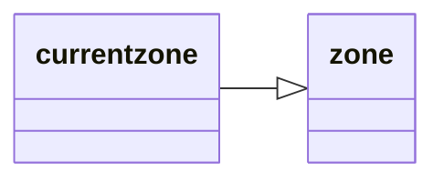

---
tags:
    - datatype
---
# `currentzone`

<!--dt-desc-start-->
Extends the [_zone_](datatype-zone.md) type with additional information about the current zone.
<!--dt-desc-end-->
## Inheritance

This type inherits members from [_zone_](datatype-zone.md).



## Members
<!--dt-members-start-->
This type inherits members from [_zone_](datatype-zone.md).

/// member | bool Dungeon
Same as Indoor.
///

/// member | int ID
the ID of the zone.
///

/// member | bool Indoor
True if this is an Indoor zone.
///

/// member | float MaxClip
Maximum clip plane allowed in zone.
///

/// member | float MinClip
Minimum clip plane allowed in zone.
///

/// member | string Name
Full zone name.
///

/// member | bool NoBind
True if binding isn't allowed in this zone outside specified bindable areas.
///

/// member | bool Outdoor
True if this is an outdoor zone.
///

/// member | string ShortName
Short zone name
///

/// member | int Type
Zone type

| Value | Meaning |
| :--- | :--- |
| 0 | Indoor Dungeon |
| 1 | Outdoor |
| 2 | Outdoor City |
| 3 | Dungeon City |
| 4 | Indoor City |
| 5 | Outdoor Dungeon |
///

/// member | int ZoneType
Same as Type
///

### [string][string] `To String`

:   Same as **Name**
<!--dt-members-end-->

## Usage

!!! example

    === "MQScript"

        ```
        | echo if the current zone is indoors:
        /echo ${Zone.Indoor}
        ```

    === "Lua"

        ```lua
        -- echo if the current zone is indoors:
        print(mq.TLO.Zone.Indoor())
        ```
<!--dt-linkrefs-start-->
[bool]: datatype-bool.md
[float]: datatype-float.md
[int]: datatype-int.md
[string]: datatype-string.md
<!--dt-linkrefs-end-->
