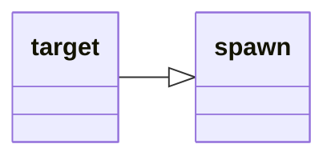

---
tags:
    - datatype
---
# `target`

<!--dt-desc-start-->
This data type represents information specific to your current target. It contains additional members for querying buff information.
<!--dt-desc-end-->
## Inheritance

This type inherits members from [_spawn_](datatype-spawn.md).



## Members
<!--dt-members-start-->
/// member | cachedbuff Aego
Returns the name of the Aego spell if the Target has one
///

/// member | spawn AggroHolder
Returns the target's current target.
///

/// member | cachedbuff Beneficial
Returns the name of the Beneficial spell if the Target has one. This will skip "player" casted buffs, but will show NPC Casted buffs and some AA buffs.
///

/// member | cachedbuff Brells
Returns the name of the Brells spell if the Target has one
///

/// member | cachedbuff Charmed
Returns the name of the Charmed spell if the Target has one
///

/// member | cachedbuff Clarity
Returns the name of the Clarity spell if the Target has one
///

/// member | cachedbuff Corrupted
Returns the name of any the Corruption spell if Target has one
///

/// member | cachedbuff Cursed
Returns the name of the Curse spell if Target has one
///

/// member | cachedbuff Crippled
Returns the name of the Cripple spell if the Target has one
///

/// member | cachedbuff Diseased
Returns the name of a Disease spell if the Target has one
///

/// member | cachedbuff Dotted
Returns the name of a DOT spell if the Target has one
///

/// member | cachedbuff DSed
Returns the name of the Damage Shield spell if the Target has one
///

/// member | cachedbuff Feared
???
///

/// member | cachedbuff Focus
Returns the name of the Focus spell if the Target has one
///

/// member | cachedbuff Growth
Returns the name of the Growth spell if the Target has one
///

/// member | cachedbuff Hasted
Returns the name of the Haste spell if the Target has one
///

/// member | cachedbuff HybridHP
Returns the name of the Hybrid HP spell if the Target has one
///

/// member | cachedbuff Invulnerable
???
///

/// member | cachedbuff Maloed
Returns the name of the Malo spell if the Target has one
///

/// member | float MaxMeleeTo
???
///

/// member | cachedbuff Mezzed
Returns the name of the Mez spell if the Target has one
///

/// member | int PctAggro
???
///

/// member | cachedbuff Poisoned
Returns the name of a Poison spell if the Target has one
///

/// member | cachedbuff Pred
Returns the name of the Predator spell if the Target has one
///

/// member | cachedbuff Regen
Returns the name of the Regen spell if the Target has one
///

/// member | cachedbuff RevDSed
Returns the name of the Reverse Damage Shield spell if the Target has one
///

/// member | cachedbuff Rooted
Returns the name of the Rooted spell if the Target has one
///

/// member | cachedbuff SE
Returns the name of the Spiritual Enlightenment spell if the Target has one
///

/// member | spawn SecondaryAggroPlayer
???
///

/// member | int SecondaryPctAggro
???
///

/// member | cachedbuff Shining
Returns the name of the Shining spell if the Target has one
///

/// member | cachedbuff Silenced
???
///

/// member | cachedbuff Skin
Returns the name of the Skin spell if the Target has one
///

/// member | cachedbuff Slowed
Returns the name of the Slow spell if the Target has one
///

/// member | cachedbuff Snared
Returns the name of the Snare spell if the Target has one
///

/// member | cachedbuff Strength
Returns the name of the Strength spell if the Target has one
///

/// member | cachedbuff SV
Returns the name of the Spiritual Vitality spell if the Target has one
///

/// member | cachedbuff Symbol
Returns the name of the Symbol spell if the Target has one
///

/// member | cachedbuff Tashed
Returns the name of the Tash spell if the Target has one
///

### [string][string] `(To String)`

:   Same as **Name**
<!--dt-members-end-->

## Examples

```
| The Delay will end when the pet is targeted...AND target buffs are
| populated, or 5 seconds, whichever is shorter.
/target pet
/delay 5s ${Target.ID}==${Pet.ID} && ${Target.BuffsPopulated}==TRUE
```
<!--dt-linkrefs-start-->
[cachedbuff]: datatype-cachedbuff.md
[float]: datatype-float.md
[int]: datatype-int.md
[spawn]: datatype-spawn.md
[string]: datatype-string.md
<!--dt-linkrefs-end-->
